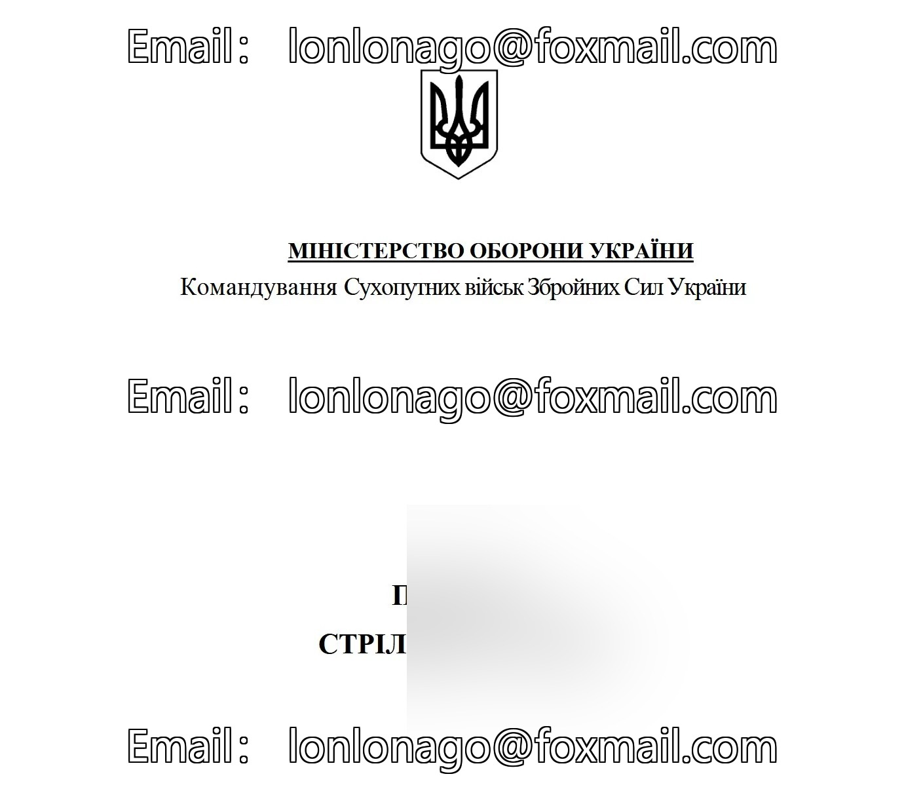
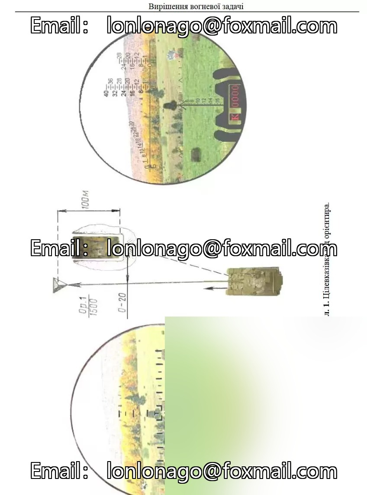
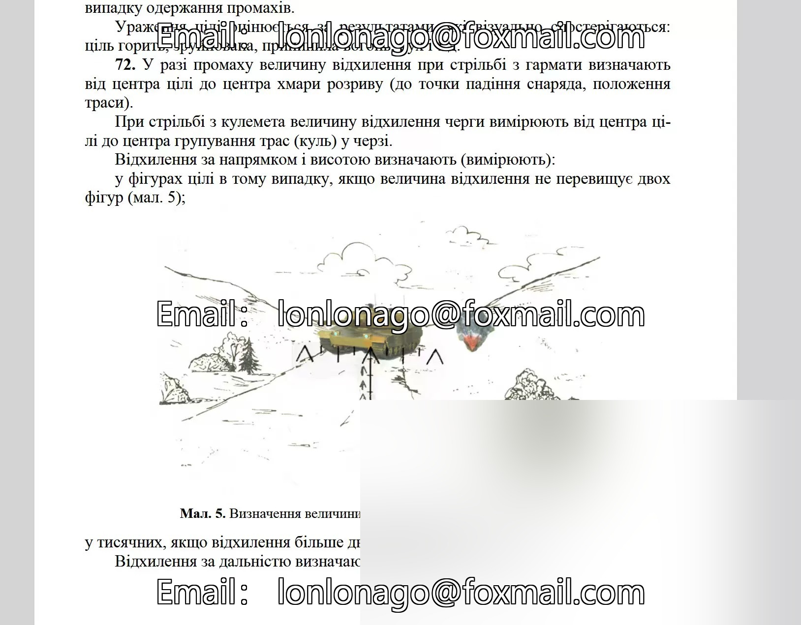

# The official document released by the Ministry of Defense of Ukraine, Army Command, "Tank Shooting Rules" (ПР)

## Body

The official document released by the Ukrainian Ministry of Defense Army Command, 《Tank Shooting Rules》 (ПРАВИЛА СТРІЛЬБИ З ТАНКІВ)
119-page PDF
Authoritative military materials, PDF format, content covering tank shooting theory, target recognition, shooting procedures, and ballistics calculation, suitable for research by military enthusiasts, professionals, and personnel.
non-returnable upon sale.
Order directly for capture, communicate issues privately.

This is the official military document released by the Ukrainian Army Command; it is a PDF file covering tank shooting theory, target recognition, firing procedures and trajectory calculations, suitable for military enthusiasts, professionals and academic research.

<!-- AI_ENRICHED -->

## Images

## Payment

Here is a pay link on Stripe ( https://buy.stripe.com/3cs8yP7sY87d0vu9AB ). Please contact me lonlonago@foxmail.com after funding $89, and I will send you a complete data files , thank you!

